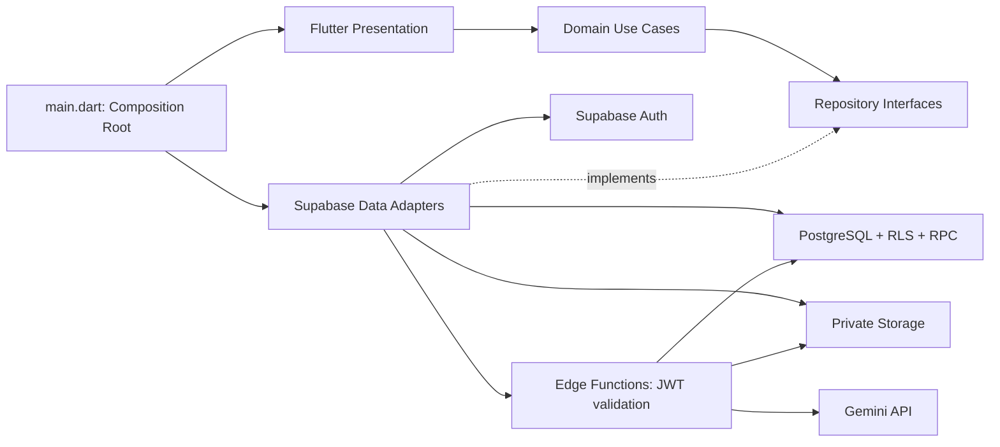

# Kiến trúc Vstudy

`domain` không import Flutter, Supabase hoặc SDK Google. Use case kiểm tra đầu vào; adapter chuyển đổi JSON và lỗi hạ tầng; `main.dart` inject implementation vào domain. UI có thể đọc qua repository interface, thao tác nghiệp vụ đi qua use case. Validation client giúp phản hồi sớm nhưng không được xem là ranh giới bảo mật: database/Edge Functions kiểm tra độc lập.

## Dữ liệu và ownership

`auth.users` → `profiles`, môn học, lịch, phiên học, tài liệu, quiz, lượt làm bài và hội thoại. Profile được tạo bởi trigger sau signup, bao gồm tài khoản đã tồn tại trước migration. Các bảng người dùng đều có RLS và quyền cụ thể; khóa ngoại tổng hợp `(id, owner_id)` chặn gắn bản ghi của người khác ngay cả khi biết UUID.

Client gửi anon/publishable key và access token của tài khoản. Service role chỉ tồn tại trong Edge runtime. Không có đáp án đúng trong `quiz_questions`; chúng nằm ở `quiz_answer_keys`, không cấp SELECT cho client. Không cho client ghi điểm/lịch sử câu trả lời AI. Quyền TRUNCATE bị thu hồi rõ ràng vì RLS không bảo vệ lệnh này.

Tệp trong bucket riêng `study-documents`, đường dẫn `USER_UUID/DOCUMENT_UUID/filename`. Khi gọi AI, server tìm metadata theo document ID **và authenticated owner**, kiểm tra đường dẫn, kích thước và kiểu nội dung, rồi tải tệp bằng service key. Không tin đường dẫn tùy ý do client truyền lên, không phát URL công khai của tài liệu.

## Luồng theo chức năng

1. **Auth:** Supabase xử lý mật khẩu/JWT; client kiểm tra email, xác nhận mật khẩu, consent. Signup trả trạng thái cần xác nhận email; không coi việc có user ID là đã có session. Recovery event mở màn hình đổi mật khẩu. Auth gate xóa các route tài khoản cũ khi danh tính thay đổi.
2. **Trang chủ:** tổng hợp profile, phiên học, lịch, quiz và hội thoại trong các query đã lọc chủ sở hữu. Tiến độ tính từ phiên học đã ghi nhận, không có số liệu cứng như “100/180” của bản thiết kế.
3. **Lịch:** RPC tạo một buổi và tối đa 52 lần lặp hàng tuần, sao chép checklist trong một transaction. Sửa/xóa một occurrence, đánh dấu checklist theo ID. Reminder mới là metadata, không giả vờ đã hẹn thông báo trên thiết bị.
4. **Quiz:** Edge gọi Gemini với JSON schema, kiểm tra số câu/lựa chọn/đáp án rồi gọi RPC transaction để lưu quiz và khóa đáp án. Khi nộp, RPC xác minh đúng tài khoản, đủ câu, đáp án hợp lệ rồi tự tính điểm. UUID bài nộp giữ ổn định khi retry; cùng UUID nhưng khác nội dung bị từ chối. Đáp án/giải thích chỉ trả sau khi nộp đủ bài.
5. **AI:** kiểm tra JWT thật bằng Auth API, khóa context tài liệu/mode của hội thoại, lấy lịch sử có giới hạn rồi gọi Gemini. Chỉ sau khi có câu trả lời hợp lệ mới ghi cả hai tin nhắn nguyên tử. Các chỉ dẫn trong tài liệu được đánh dấu là dữ liệu tham khảo, không phải system prompt. Câu trả lời không được thực thi như lệnh hay tự sửa lịch/database.
6. **Thống kê:** pure function chia khoảng học qua nửa đêm, cắt theo cửa sổ `[from,to)` và thời điểm hiện tại. Có ngày trống, streak liên tục và điểm trung bình phần trăm. Lịch sử được phân trang, không âm thầm giới hạn ở 1000 bản ghi mặc định của PostgREST. Tải lịch sử phiên học trước cửa sổ để tính streak liên tục; khi dữ liệu lớn có thể chuyển tổng hợp sang RPC/materialized views.

## Giới hạn tài nguyên AI

Database kiểm tra tối đa 30 yêu cầu/phút/tài khoản và lease 120 giây để chặn xử lý đồng thời trên cùng hội thoại/tác vụ tạo mới. Đây là giới hạn kỹ thuật, chưa phải hạn mức chi phí ngày/tháng hay gói thuê bao. Khi phát hành, đặt thêm quota/budget Gemini theo nhu cầu.

Edge giới hạn body, độ dài tin nhắn, tệp và lịch sử (tối đa 20 tin/40.000 ký tự), có timeout, không trả nội dung lỗi kỹ thuật hoặc khóa ra UI. Gemini không được cấp quyền database: Edge Functions chỉ dùng hai RPC đã định nghĩa để lưu quiz/chat.
